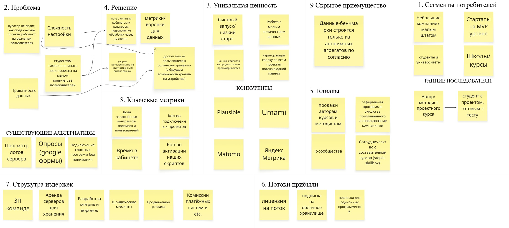

# ДЗ №1,2,3 по предмету "Управление разработкой ПО"
**Студент:** Попов Т.Д. 
**Группа:** ИУ5-36Б, WEB-11

---

## 📦 SmallAud
> Приложение, помогающее небольшим разработчикам, стартапам на уровне разработки MVP.
> Бизнес модель - B2C

---

### 🎯 Задание №1:
### Elevator Pitch
Начинающие разработчики и стартапы на этапе MVP не понимают, на каком шаге пользователи бросают их продукт: у них нет большой аудитории, а большинство инструментов аналитики рассчитано на большой трафик или требует сложной настройки. SmallAud - сервис аналитики для проверки продукта на малой аудитории, около 50 пользователей. Вы подключаете один JS-скрипт за 5 минут и сразу видите воронку, путь каждого пользователя и подсказки, где вы теряете людей. В отличие от Plausible и Umami, у нас есть воронки и разбор поведения; в отличие от Matomo, нет дорогих плагинов; в отличие от Яндекс Метрики, данные остаются под вашим контролем и не используются для рекламы. Базовый тариф бесплатный, расширенные функции от 5 $ в месяц. Сейчас мы ищем инвестрово - хотите посмотреть наш MVP?

### 📊 Lean Canvas

### 🎯 Задание №2:
###  Сформулируйте HADI-гипотезу:
Выберите самый критичный риск из Lean Canvas и распишите для нее гипотезу.

H: Верим, что начинающие разработчики, у которых 20–50 тестовых пользователей, готовы платить за готовый разбор, где пользователи бросают продукт

A: Собственноручно проверим продукт клиента на 50 человеках, соберём фидбек и составим отчёт

D: Результаты опроса, где от 0-10 спрашивали: "Помог ли вам наш отчёт", "Что нам лучше добавить в отчётность?", "Хотите вы заказать отчёт ещё раз", "На каких этапах вы бы воспользовались?".

I: минимум 3 из 10 разработчиков ставят 8+ из 10 и минимум 2 готовы предоплатить 5 $ - зачит идея вполне реальная и нужно заниматься улучшениме её реализации

###  Рассчитайте базовую Юнит-экономику:
Опишите предполагаемую воронку: стоимость трафика, конверсию в покупку и итоговый CAC. Рассчитайте LTV на основе вашего чека и частоты покупок. Рассчитайте сходимость экономики.

Расчёт на год.

CAC:
- продвижение продукта на разных площадках - 1,5$.
итого: платящих - на 100 человек 3 человека - 150/3 = 50 $ на 1 платящего.

LTV:
     пусть средний платящий пользователь платит по 8 мес в год.

- Basic Pass - 5$/мес базовый пакет с возможностью вести до 5 проектов, расширенным облачным хранилищем и доступ к воронкам и базовой оценке. Пусть 0,6  -  1,8 из 100 платят
- Middle Pass - 35$/мес средний пакет с возможностью до 20 проектов, доступ почти ко всем инструментам, метрикам, а также анализ данных с коментариями и красивыми графиками, где пользователи проходят. Пусть 0,3 - 0,009 * 100 = 0,9 из 100 платят
- Max - 100$/мес максимальный пакет с возможностью вести 50 проектов, большой объём хранилища (от 1 ТБ), анализ до 1000 активных пользователей на сайтах. Пусть за это платит 0,1 - 0,003 * 100 = 0,3 из 100 платят
- аренда серверов для высчитывания информации ~ 20$ в год на 100 пользователей.
- аренда серверов для хранения информации ~ 20$ в год на 100 пользователей. По 1 Гб на проект в базовой версии

итого: на 100 человек прибыли (1,8 * 5 + 0,9 * 35 + 0,3 * 100) * 8 - 40 = 524$, на 1 платящего 174$

### LTV/CAC = 3,48 > 3, значит экономика сходится, но для надёжности рассмотрим pivot, как план Б.

### Спроектируйте План Б:
Если математика не сошлась — сделайте Pivot. Если на бумаге всё идеально — спроектируйте Pivot как резервный план.

Тип Pivot: Customer Segment + Revenue Pivot (смена сегмента и модели оплаты).
Бизнес план - B2C, B2B
Что меняется: покупатель, а не продукт. Сейчас платит отдельный начинающий разработчик, у которого низкая готовность платить, высокий отток после теста и бесплатный Clarity под рукой. После Pivot платит организация, которая обучает начинающих разработчиков: онлайн-школы, буткемпы, университетские курсы (Stepik, Skillbox и подобные, которые уже указаны в каналах).

### Elevator Pitch
На курсах программирования студенты делают учебные проекты, но у этих проектов почти нет реальных пользователей. Поэтому ни студент, ни куратор не видят, на каком шаге люди бросают продукт и что исправлять. SmallAud — сервис аналитики для учебных проектов. Студент подключает один скрипт за 5 минут, а куратор в одной панели видит воронки, ошибки и точки потери по каждому проекту потока. В отличие от Plausible, Umami и Яндекс Метрики, мы заточены под малую аудиторию, около 50 пользователей, и под работу с целой группой, а данные не продаются и не используются для рекламы. Школа платит лицензию на поток, ориентировочно 100 $ в месяц за группу, для студентов сервис бесплатный. Сейчас мы ищем 2–3 курса для пилота на одном потоке. Готовы обсудить?

### 📊 Lean Canvas

### 🎯 Задание №3:
1. Роли и User Stories
Роль	Кто это	Чем отличаются потребности
Р1. Одиночный разработчик	Новичок, один проект, бесплатный тариф	Нужны простота, быстрый старт и понятные подсказки без знаний аналитики
Р2. Основатель/продакт стартапа	Команда 2–5 человек, MVP-стадия	Принимает решения по метрикам и воронкам, платит за тариф
Р3. Разработчик-интегратор	Подключает скрипт и API в проект стартапа	Нужно убедиться, что данные приходят корректно

Истории (19 штук):

- Р1: Как одиночный разработчик, я хочу зарегистрироваться по e-mail, чтобы быстро начать работу без долгой настройки.
- Р1: Как одиночный разработчик, я хочу создать проект и получить готовый JS-сниппет, чтобы подключить аналитику одной строкой.
- Р1: Как одиночный разработчик, я хочу, чтобы просмотры страниц, клики, скроллы и ошибки собирались автоматически, чтобы сразу видеть данные без ручной разметки.
- Р3: Как интегратор, я хочу видеть статус подключения (пришли ли первые события), чтобы убедиться, что интеграция работает.
- Р3: Как интегратор, я хочу отправлять свои события через API/SDK, чтобы отслеживать действия, которые сниппет сам не видит.
- Р2: Как основатель, я хочу видеть, вернулся ли пользователь на 1-й и 7-й день, чтобы оценить удержание.
- Р2: Как основатель, я хочу задать шаги воронки и увидеть конверсию по шагам, общую конверсию и график переходов, чтобы понять, где пользователи бросают продукт.
- Р2: Как основатель, я хочу видеть время до ключевого действия и долю активации новых пользователей, чтобы оценить онбординг.
- Р2: Как основатель, я хочу видеть глубину и длительность сессий, чтобы понять, насколько продукт вовлекает.
- Р1: Как одиночный разработчик, я хочу видеть путь отдельного пользователя в виде ленты событий, чтобы понять, что он делал перед уходом.
- Р1: Как одиночный разработчик, я хочу видеть долю сессий с ошибками и rage clicks, чтобы находить баги и неудобные места.
- Р1: Как одиночный разработчик, я хочу получать простые подсказки («70% уходят на шаге 3»), чтобы понимать, что исправлять.
- Р2: Как основатель, я хочу видеть предупреждение «мало данных для вывода», чтобы не принимать решения по случайным колебаниям.
- Р2: Как основатель, я хочу включать и отключать метрики на панели, чтобы видеть только нужные.
- Р2: Как основатель, я хочу использовать готовые шаблоны анализа (онбординг, регистрация, оплата), чтобы запустить воронку в один клик.
- Р2: Как основатель, я хочу сравнить свои показатели с анонимными бенчмарками похожих MVP, чтобы понять, хорошо это или плохо.
- Р1: Как одиночный разработчик, я хочу выбрать, участвуют ли мои данные в бенчмарках, чтобы сохранить контроль над данными.
- Р1: Как одиночный разработчик, я хочу удалить проект и все его данные, чтобы они не хранились без необходимости.
- Р2: Как основатель, я хочу оформить платный тариф, чтобы вести больше проектов и получить больше хранилища.
### 2. Приоритизация функционала (по методу MoSCoW)

M (Must have - обязаны сделать):

- Регистрация по e-mail;
- Создание проекта и получение JS-сниппета;
- Автоматический сбор просмотров страниц, кликов, скроллов и ошибок;
- Статус подключения (пришли ли первые события);
- Воронка по шагам с конверсией и графиком переходов;
- Лента событий отдельного пользователя;
- Предупреждение «мало данных для вывода»;
- Удаление проекта и всех его данных;

S (Should have - должны сделать):

- Подсказки на понятном языке («70% уходят на шаге 3»);
- Возвращаемость на 1-й и 7-й день;
- Время до ключевого действия и доля активации;
- Доля сессий с ошибками и rage clicks;
- Глубина и длительность сессий;
- Готовые шаблоны анализа (онбординг, регистрация, оплата);

C (Could have - могли бы сделать):

- Включение и отключение метрик на панели;
- API/SDK для отправки собственных событий;
- Платные тарифы и оплата подписки;

W (Won’t have - не будет в этой версии):

- Анонимные бенчмарки и согласие на участие в них (нужны данные многих проектов);
- Видеозапись сессий (session replay);
- Мобильные SDK для iOS и Android;
- Self-hosted версия;
### 3. MVP и MLP

- MVP
Проверяем ценность: понимает ли начинающий разработчик без аналитической подготовки, где его первые 50 пользователей бросают продукт. Нет подсказок, шаблонов, платных тарифов и дополнительных метрик. Разработчик регистрируется, вставляет один скрипт и через несколько минут видит воронку.

Включенный функционал:

- Регистрация по e-mail и создание проекта.
- Готовый JS-сниппет для подключения одной строкой.
- Автоматический сбор просмотров страниц, кликов, скроллов и ошибок.
- Статус подключения (первые события получены).
- Воронка из 2–10 шагов с конверсией по шагам, общей конверсией и графиком переходов.
- Лента событий отдельного пользователя.
- Предупреждение «мало данных» при малой выборке.
- Удаление проекта и всех данных.

MLP

Включенный функционал:

- Подсказки на понятном языке с указанием шага, где уходит больше всего людей.
- Готовые шаблоны анализа (онбординг, регистрация, оплата) в один клик.
- Остальные метрики: возвращаемость на 1-й и 7-й день, время до ключевого действия, активация, глубина и длительность сессий, доля сессий с ошибками и rage clicks.
- Настройка панели: включение и отключение метрик.
- API/SDK для собственных событий.
- Платные тарифы и оплата подписки.

### 4. Детализация требований для MVP

История 3 - Автоматический сбор событий

Функциональные требования:

- Система должна после вставки одного JS-сниппета на страницу автоматически собирать просмотры страниц, клики, глубину скролла (25/50/75/100%) и необработанные JS-ошибки без дополнительной разметки.
- Система должна присваивать каждому посетителю анонимный идентификатор и объединять его события в единую цепочку без сбора личных данных.
- Система не должна собирать значения полей ввода (пароли, тексты форм), а должна передавать только факт взаимодействия с полем.

Нефункциональные требования:

- Скрипт должен весить не более 10 КБ (gzip) и загружаться асинхронно, увеличивая время загрузки страницы не более чем на 50 мс.
- Доставка событий должна происходить пакетами с использованием navigator.sendBeacon при закрытии вкладки; потеря событий не должна превышать 1%, при недоступности сервера отправка должна повторяться.
- Ошибка внутри скрипта не должна нарушать работу сайта клиента; скрипт должен работать в последних двух версиях Chrome, Firefox, Safari и Edge, включая мобильные браузеры.
- Передача данных должна происходить только по HTTPS (TLS 1.2+), без сторонних cookies и без сохранения IP-адреса; сервис должен принимать не менее 100 000 событий в сутки на проект и ограничивать частоту запросов от одного источника.

История 7 - Воронка и график переходов

Функциональные требования:

- Система должна позволять создать и сохранить воронку из 2–10 шагов, где шаг задаётся страницей (URL) или кликом по элементу.
- Система должна для выбранного периода (7 дней, 30 дней или свой диапазон) показывать число пользователей на каждом шаге, конверсию относительно предыдущего шага и общую конверсию.
- Система должна отображать график переходов (сколько человек дошло до каждого этапа и сколько ушло между этапами) и выделять шаг с наибольшей потерей.
- Система должна позволять открыть список ушедших на выбранном шаге и перейти к ленте событий конкретного пользователя.

Нефункциональные требования:

- Расчёт и отображение воронки должны занимать не более 3 с при объёме до 100 000 событий за выбранный период.
- Каждый пользователь должен учитываться на шаге один раз с соблюдением порядка шагов по времени; результат на тестовом наборе должен совпадать с ручным расчётом.
- Рядом с каждым процентом система должна показывать число пользователей (n) и пометку «мало данных» при n < 30.
- Разработчик без документации должен собрать воронку из трёх шагов не более чем за 2 минуты (проверка на 5 тестовых пользователях); интерфейс должен корректно отображаться на экранах от 1280 px.
- Пользователь должен видеть только данные своих проектов; права доступа должны проверяться при каждом запросе, доступ возможен только после аутентификации.
